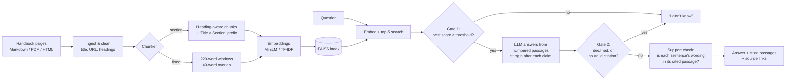

# GroundTruth — a RAG assistant that shows its receipts

MSAI-630-M40 Residency Hackathon · Project 1

GroundTruth answers questions about the **TTS Handbook "Travel & Leave" policies**
(GSA's public-domain employee handbook: 23 pages, ~22k words). Every answer cites
the passages it used, and when the documents don't support an answer it says
**"I don't know."**

**Who it's for:** a federal employee asking at 11 PM, "How much leave can I carry
over?" or "Will this travel expense get reimbursed?" A confident wrong answer
costs them real money: forfeited leave, or an expense they pay out of pocket.

---

## Quick start (5 minutes)

```bash
git clone <your-repo-url> groundtruth && cd groundtruth
python -m venv .venv && source .venv/bin/activate     # Windows: .venv\Scripts\activate
pip install -r requirements.txt
cp .env.example .env          # then put your LLM key/model in .env
python scripts/build_index.py # downloads the embedding model the first time (~90 MB)
python app.py                 # open http://127.0.0.1:7860
```

Produce every number for the slides with one command:

```bash
bash run_all.sh               # ~5-10 min, writes eval/results/report.md + charts
```

**No API key yet?** `LLM_PROVIDER=extractive` runs the whole thing with no model
(it quotes the best-matching sentences). `GT_EMBEDDER=tfidf` skips the embedding
download. Both are also the baselines in the evaluation.

### Picking an LLM

Any of these work; set them in `.env` (examples in `.env.example`). Check your
provider's docs for current model names.

| Option | `LLM_PROVIDER` | Notes |
|---|---|---|
| Groq | `openai` + Groq base URL | Free tier, very fast. Good default. |
| OpenAI | `openai` | |
| Anthropic | `anthropic` | |
| Gemini | `openai` + Gemini's OpenAI-compatible URL | Free tier |
| Ollama | `openai` + `http://localhost:11434/v1` | Fully local; no key; slower |

Confirm your key works before anything else:
`python -c "from groundtruth.config import get_config; from groundtruth.llm import make_llm; print(make_llm(get_config()).complete('Say OK', 'ping'))"`

---

## Architecture



| File | What it does |
|---|---|
| `groundtruth/ingest.py` | Loads Markdown/PDF/HTML/TXT; strips templating; keeps headings, title and source URL |
| `groundtruth/chunking.py` | `fixed` (sliding window) and `section` (heading-aware, with section-path prefix) chunkers |
| `groundtruth/embeddings.py` | sentence-transformers (local), OpenAI-compatible, or TF-IDF |
| `groundtruth/index.py` | FAISS inner-product index (cosine), saved to `index/` |
| `groundtruth/llm.py` | One `complete()` interface for OpenAI-compatible, Anthropic, or no-LLM |
| `groundtruth/rag.py` | The pipeline: retrieve → gate 1 → prompt → gate 2 → support check |
| `groundtruth/evaluation.py` | Metrics, failure taxonomy, optional LLM judge |
| `app.py` | Gradio UI: chat on the left, retrieved passages (cited ones highlighted) on the right |

**Why two refusal gates?** Gate 1 is cheap and catches obviously off-topic
questions ("What's the capital of France?") without spending an LLM call. But the
dangerous questions are the *plausible* ones ("What's the M&IE rate in Boston?")
where retrieval finds related text. Those reach the LLM, which must decline; and
if it answers without citing anything, gate 2 blocks the answer anyway.

---

## Evaluation

### The test set (`eval/questions_test.jsonl`)

30 hand-written questions, written **before** looking at any model output:

| Category | n | What it tests |
|---|---|---|
| single_fact | 16 | One fact from one passage |
| reasoning | 2 | Apply a rule (e.g. "5 years of service" → the 3–15 years bracket) |
| multi_hop | 3 | Combine two facts, sometimes from different sections |
| confusable | 2 | Near-identical facts with different answers (comp time *paid out* vs. travel comp time *forfeited*; 240 h carryover vs. 240 h advanced sick leave) |
| unanswerable_tempting | 5 | Sounds answerable and the model probably "knows" an answer from training (Boston M&IE rate, mileage rate, business class over 14 h) |
| unanswerable_out_of_scope | 2 | Plausible HR questions the handbook doesn't cover (holidays, TSP match) |

Each answerable question has **key facts** (for correctness), exact **evidence**
strings from the source (for retrieval and citation checks; all verified to exist
in the corpus), and a **stakes** rating. Each unanswerable one notes the **trap**:
what a model would wrongly say. A separate 9-question **dev set** is used only to
calibrate the refusal threshold, so the test set stays clean.

### Metrics

| Metric | Definition |
|---|---|
| **Answer correctness** | Answerable questions where the answer contains every key fact |
| **Citation faithfulness** | Answered questions where the *cited* passages contain the gold evidence |
| **Sentence support rate** | Share of answer sentences whose content words appear in the passages they cite (catches numbers that came from nowhere) |
| **Refusal accuracy** | Unanswerable questions where the system said "I don't know" |
| **False refusal rate** | Answerable questions where it said "I don't know" — a system that refuses everything scores 100% refusal accuracy, so this number keeps it honest |
| **Retrieval hit@k / MRR** | Gold evidence in the top-k passages / reciprocal rank |
| **Harm-weighted error** | Errors weighted by stakes (high = 3, medium = 2, low = 1) |
| **LLM judge** (optional, `--judge`) | Second opinion on correctness and per-sentence citation support |

Every failure gets one label, so you can tell **retrieval** problems from
**generation** problems:
`retrieval_miss` · `false_refusal` · `wrong_answer` · `correct_bad_citation` · `hallucinated`.

### Running it

```bash
python eval/calibrate_threshold.py --write        # dev set only
python eval/run_eval.py --judge                   # test set, writes eval/results/<tag>/
python eval/compare_chunking.py --embedders st tfidf   # stretch goal
python eval/make_report.py                        # report.md + charts
```

### Baseline results (no LLM, TF-IDF retrieval)

These came from the offline baseline, run while building the repo. **Replace them
with your LLM + MiniLM numbers from `run_all.sh`.** They're still worth keeping on a
slide as the "what does the LLM add?" comparison.

| | Section 220w | Fixed 220w |
|---|---|---|
| Answer correctness | 70% | 74% |
| Citation faithfulness | 77% | 86% |
| Refusal accuracy (7 unanswerable) | 43% | 43% |
| False refusal rate | 4% | 9% |
| Retrieval hit@5 | 91% | 91% |

Retrieval-only chunking comparison (TF-IDF): bigger chunks retrieved better
(400-word chunks reached 96% hit@5 vs. 83–91% at 120 words). Heading-aware
chunking did **not** beat fixed windows with a lexical retriever. That's an honest
finding worth testing with dense embeddings: the section-path prefix is meant to
help semantic matching, not keyword matching.

The baseline's 4 hallucinations on unanswerable questions show why the retrieval
gate alone isn't enough: "Boston M&IE rate" retrieves real M&IE passages with a
high score. Refusing those has to come from the model reading the passages, which
is exactly what the LLM runs measure.

---

## Swapping in a different document set

Drop PDFs, Markdown, HTML or TXT into `data/raw/` (subfolders are fine), set
`GT_SOURCE_BASE_URL` (or leave it empty to cite file paths), then rebuild:
`python scripts/build_index.py`. The questions in `eval/` are specific to this
handbook, so a new corpus needs a new `eval/make_questions.py`.

## Data and license

`data/raw/travel-and-leave/` is the "Travel & Leave" section of the
[TTS Handbook](https://handbook.tts.gsa.gov/) (repo `GSA-TTS/handbook`,
snapshot of June 4, 2026). It's a work of the U.S. Government, public domain and
CC0 (see `data/CORPUS-LICENSE.md`). Some pages are years old (e.g. the 07/13/2021
COVID travel guidance); see the ethics notes.

## Team docs

- `docs/demo-and-ethics.md`: demo script, slide outline, ethics & risk analysis, Q&A prep
- `eval/results/report.md`: generated results and failure log
