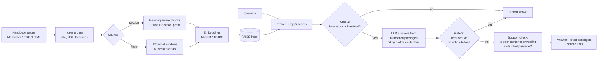

# GroundTruth — a RAG assistant that shows its receipts

MSAI-630-M40 Residency Hackathon · Project 1

GroundTruth answers questions over **two separate document sets**, each in its own
tab of the app. Every answer cites the passages it used (with page numbers for the
PDF), and when the documents don't support an answer it says **"I don't know."**

| Tab | Document set | Size | Questions |
|---|---|---|---|
| **UC Student Handbook** | University of the Cumberlands Student Handbook 2026-2027 (PDF) | 81 pages, ~51k words, 341 chunks | 32 test (7 unanswerable, 2 where the handbook contradicts itself) + 9 dev |
| **TTS Travel & Leave** | GSA TTS Handbook, Travel & Leave section (public domain) | 23 pages, ~22k words, 178 chunks | 30 test (7 unanswerable) + 9 dev |

The two sets never mix: each has its own index, refusal threshold, test questions
and results. A question asked in one tab only searches that tab's documents.

**Team benchmark (UC, 40 questions).** The team wrote a harder set before seeing
any output: multi-step, false premise, calculations, date comparisons, exceptions
and 8 unanswerable questions (`eval/UC_GroundTruth_40_Question_Benchmark.xlsx`).
`eval/make_questions_uc_hard.py` converts it, adding exact handbook quotes and
answer keywords; `eval/fill_benchmark_sheet.py` writes fixed-size vs
section-based results back into a copy of the sheet with a paired comparison by
category (`eval/results/UC_benchmark_results.xlsx`). Following the team's rule,
an unanswerable question is scored correct when the system declines to invent
the missing detail, even if it cites nearby policy.

**Who it's for:** a federal employee asking at 11 PM, "How much leave can I carry
over?" or "Will this travel expense get reimbursed?" A confident wrong answer
costs them real money: forfeited leave, or an expense they pay out of pocket.

---

## Quick start (5 minutes)

```bash
git clone <your-repo-url> groundtruth && cd groundtruth
python -m venv .venv && source .venv/bin/activate     # Windows: .venv\Scripts\activate
pip install -r requirements.txt
cp .env.example .env          # then put your LLM key/model in .env
python scripts/build_index.py # downloads the embedding model the first time (~90 MB)
python app.py                 # open http://127.0.0.1:7860
```

Produce every number for the slides with one command per document set:

```bash
bash run_all_uc.sh            # UC Student Handbook  -> eval/results/report_uc.md + *_uc.png
bash run_all.sh               # TTS Travel & Leave   -> eval/results/report.md + charts
```

Every script takes `--corpus uc` or `--corpus tts` (default `tts`), e.g.
`python eval/run_eval.py --corpus uc`.

**No API key yet?** `LLM_PROVIDER=extractive` runs the whole thing with no model
(it quotes the best-matching sentences). `GT_EMBEDDER=tfidf` skips the embedding
download. Both are also the baselines in the evaluation.

### Picking an LLM

Any of these work; set them in `.env` (examples in `.env.example`). Check your
provider's docs for current model names.

| Option | `LLM_PROVIDER` | Notes |
|---|---|---|
| Groq | `openai` + Groq base URL | Free tier, very fast. Good default. |
| OpenAI | `openai` | |
| Anthropic | `anthropic` | |
| Gemini | `openai` + Gemini's OpenAI-compatible URL | Free tier |
| Ollama | `openai` + `http://localhost:11434/v1` | Fully local; no key; slower |

Confirm your key works before anything else:
`python -c "from groundtruth.config import get_config; from groundtruth.llm import make_llm; print(make_llm(get_config()).complete('Say OK', 'ping'))"`

---

## Architecture



| File | What it does |
|---|---|
| `groundtruth/corpora.py` | The two document sets: folders, source links, example questions |
| `scripts/pdf_to_markdown.py` | Turns a PDF into Markdown using its bookmarks as headings and keeping page markers |
| `groundtruth/ingest.py` | Loads Markdown/PDF/HTML/TXT; strips templating; keeps headings, title, source URL and page numbers |
| `groundtruth/chunking.py` | `fixed` (sliding window) and `section` (heading-aware, with section-path prefix) chunkers |
| `groundtruth/embeddings.py` | sentence-transformers (local), OpenAI-compatible, or TF-IDF |
| `groundtruth/index.py` | FAISS inner-product index (cosine), saved to `index/` |
| `groundtruth/llm.py` | One `complete()` interface for OpenAI-compatible, Anthropic, or no-LLM |
| `groundtruth/rag.py` | The pipeline: retrieve → gate 1 → prompt → gate 2 → support check |
| `groundtruth/evaluation.py` | Metrics, failure taxonomy, optional LLM judge |
| `app.py` | Gradio UI: one tab per document set; chat on the left, retrieved passages (cited ones highlighted, page links into the PDF) on the right |

**Why two refusal gates?** Gate 1 is cheap and catches obviously off-topic
questions ("What's the capital of France?") without spending an LLM call. But the
dangerous questions are the *plausible* ones ("What's the M&IE rate in Boston?")
where retrieval finds related text. Those reach the LLM, which must decline; and
if it answers without citing anything, gate 2 blocks the answer anyway.

---

## Evaluation

### The test set (`eval/questions_test.jsonl`)

30 hand-written questions, written **before** looking at any model output:

| Category | n | What it tests |
|---|---|---|
| single_fact | 16 | One fact from one passage |
| reasoning | 2 | Apply a rule (e.g. "5 years of service" → the 3–15 years bracket) |
| multi_hop | 3 | Combine two facts, sometimes from different sections |
| confusable | 2 | Near-identical facts with different answers (comp time *paid out* vs. travel comp time *forfeited*; 240 h carryover vs. 240 h advanced sick leave) |
| unanswerable_tempting | 5 | Sounds answerable and the model probably "knows" an answer from training (Boston M&IE rate, mileage rate, business class over 14 h) |
| unanswerable_out_of_scope | 2 | Plausible HR questions the handbook doesn't cover (holidays, TSP match) |

Each answerable question has **key facts** (for correctness), exact **evidence**
strings from the source (for retrieval and citation checks; all verified to exist
in the corpus), and a **stakes** rating. Each unanswerable one notes the **trap**:
what a model would wrongly say. A separate 9-question **dev set** is used only to
calibrate the refusal threshold, so the test set stays clean.

### Metrics

| Metric | Definition |
|---|---|
| **Answer correctness** | Answerable questions where the answer contains every key fact |
| **Citation faithfulness** | Answered questions where the *cited* passages contain the gold evidence |
| **Sentence support rate** | Share of answer sentences whose content words appear in the passages they cite (catches numbers that came from nowhere) |
| **Refusal accuracy** | Unanswerable questions where the system said "I don't know" |
| **False refusal rate** | Answerable questions where it said "I don't know" — a system that refuses everything scores 100% refusal accuracy, so this number keeps it honest |
| **Retrieval hit@k / MRR** | Gold evidence in the top-k passages / reciprocal rank |
| **Harm-weighted error** | Errors weighted by stakes (high = 3, medium = 2, low = 1) |
| **LLM judge** (optional, `--judge`) | Second opinion on correctness and per-sentence citation support |

Every failure gets one label, so you can tell **retrieval** problems from
**generation** problems:
`retrieval_miss` · `false_refusal` · `wrong_answer` · `correct_bad_citation` · `hallucinated`.

### Running it

```bash
python eval/calibrate_threshold.py --write        # dev set only
python eval/run_eval.py --judge                   # test set, writes eval/results/<tag>/
python eval/compare_chunking.py --embedders st tfidf   # stretch goal
python eval/make_report.py                        # report.md + charts
```

### Results: TTS Travel & Leave (Groq `openai/gpt-oss-120b`, MiniLM embeddings)

| | No LLM (quotes best sentences) | LLM + fixed 220w chunks | **LLM + section 220w chunks** |
|---|---|---|---|
| Answer correctness | 74% | 96% | **100%** |
| Citation faithfulness | 74% | 91% | **100%** |
| Refusal accuracy (7 unanswerable) | 43% | 100% | **100%** |
| False refusal rate | 0% | 0% | **0%** |
| Retrieval hit@5 | 100% | 91% | **100%** |

A perfect score means this first test set was too easy, which is why the UC
handbook set adds harder categories (calculations, contradictions in the source).
Two bugs found on the way, and fixed: Groq rate limits were being counted as
"I don't know", and gpt-oss cites as `【1】`, which the citation check didn't
recognize (`groundtruth/rag.py: normalize_citations`).

### Results: UC Student Handbook

Run `bash run_all_uc.sh` and paste the table from `eval/results/report_uc.md`
here. Offline baseline (TF-IDF, no LLM), for reference: 44% correct, 2 of 7 trick
questions refused, retrieval hit@5 92%.

---

## Stretch goal and course connection

### Stretch goal: two chunking strategies and two embedding models, with numbers

`eval/compare_chunking.py` scores retrieval on the test questions for every
combination of:

- **Chunking:** heading-aware `section` chunks (each chunk prefixed with its
  "Section > Subsection" path) vs `fixed` sliding windows, at 120 / 220 / 400 words
- **Embeddings:** two dense neural models, **MiniLM** (`all-MiniLM-L6-v2`, 384-d)
  and **BGE-small** (`bge-small-en-v1.5`, 384-d), plus **TF-IDF** as a keyword
  baseline with no learned representation

Metrics: hit@1/3/5 and MRR (does the right passage come back, and how high?),
and AUROC (does the top similarity score separate answerable from unanswerable
questions?). Results: `eval/results/chunking_comparison_uc.{md,png}` and
`chunking_comparison.{md,png}`. The end-to-end runs also compare section vs fixed
chunks with the LLM in the loop.

**End to end, 2×2:** `bash run_grid_uc.sh` runs the team's 40-question UC
benchmark through all four systems ({section, fixed} chunking × {MiniLM,
BGE-small}), each with its own index and its own "I don't know" threshold
calibrated on the dev set (`GT_MIN_SCORE_UC_<CHUNKER>_<MODEL>` in `.env`). The
"Paired comparison" tab of `eval/results/UC_benchmark_results.xlsx` holds the
2×2 table of correct answers. In the app, the UC tab's Settings panel switches
between the four systems, and the **UC 2×2 Lab** tab sends one question to all
four at once.

TTS finding so far: with MiniLM, section chunks reached 100% hit@5 at every size
vs 87-91% for fixed windows, while with TF-IDF the section prefix made no
difference. The section path helps the *semantic* embedding place a chunk, not
keyword matching.

### Course connection

| Course idea | Where it shows up in GroundTruth | Evidence |
|---|---|---|
| **Conditional generation p(x \| context)** | The LLM generates the answer conditioned on the retrieved passages; the prompt forbids using anything else, and an answer with no citation is blocked. Conditioning on *wrong* context is the main failure mode, so retrieval quality is measured separately from generation. | No-LLM vs LLM runs; `retrieval_miss` vs `wrong_answer` in the failure taxonomy |
| **Generalization vs memorization** | Trick questions have answers the model has probably *memorized* (Boston meals rate, mileage rate, federal holidays, tuition). A correct system answers from the context, not its memory, so it must refuse. The UC handbook is also a generalization test: the system was built and tuned on TTS, then run unchanged on a document it had never seen. Thresholds are set on dev questions, never on test. | Refusal accuracy on unanswerable questions; TTS vs UC results side by side |
| **Latent space applied to text embeddings** | Every chunk and question is a point in a 384-d embedding space; retrieval is nearest-neighbour search by cosine similarity, and the "I don't know" gate is a distance cut. `eval/plot_latent_space.py` projects the space to 2D and shows how close trick questions land to real passages: too close for a distance cut alone, which is why the LLM must also decline. | `latent_space_uc.png`, `similarity_gap_uc.png`; AUROC column in the comparison |

## The UC Student Handbook

`data/uc/Student_Handbook_2026_2027.pdf` is converted once into
`data/uc/text/student-handbook.md` by `scripts/pdf_to_markdown.py`:

- The PDF's 199 bookmarks become headings, so each chunk is labeled with its
  section path (e.g. *Policies and Regulations > Withdrawal from the University*).
- A page marker at every page start gives each chunk its page number (checked:
  338 of 341 chunks cite the right PDF page).
- Pages 30-33 are drug-schedule tables that extract one cell per line; they are
  skipped as noise, and the app's footer says so.
- The converted file is committed, so laptops that can't install PyMuPDF still work.

Re-run the conversion only if the PDF changes:
`python scripts/pdf_to_markdown.py data/uc/Student_Handbook_2026_2027.pdf data/uc/text/student-handbook.md --title "UC Student Handbook 2026-2027"`

**The handbook contradicts itself in places**, and two test questions probe this
(category `conflicting`): skateboards on sidewalks are *not permitted* on p.58 but
*required* ("sidewalks only") on p.66, and the alcohol-education course is
"Alcohol Wise" on p.27 but "AlcoholEdu" on p.48. A good answer reports both
passages; a confident single answer is graded wrong. Other inconsistencies worth
knowing for Q&A: towed cars are retrieved via "Parking Control, Office of Public
Safety" (p.61) or "the UC Travel Services Office" (p.62); the health clinic is
open 8:00-4:30 (p.65) or closed 12-1 (facilities schedule).

## Swapping in a different document set

Drop PDFs, Markdown, HTML or TXT into `data/raw/` (subfolders are fine), set
`GT_SOURCE_BASE_URL` (or leave it empty to cite file paths), then rebuild:
`python scripts/build_index.py`. The questions in `eval/` are specific to this
handbook, so a new corpus needs a new `eval/make_questions.py`.

## Data and license

`data/uc/` is the University of the Cumberlands Student Handbook 2026-2027,
provided by the team for this course project. It is the university's
publication; this repo is public, so make it private after the residency if the
course requires it.

`data/raw/travel-and-leave/` is the "Travel & Leave" section of the
[TTS Handbook](https://handbook.tts.gsa.gov/) (repo `GSA-TTS/handbook`,
snapshot of June 4, 2026). It's a work of the U.S. Government, public domain and
CC0 (see `data/CORPUS-LICENSE.md`). Some pages are years old (e.g. the 07/13/2021
COVID travel guidance); see the ethics notes.

## Team docs

- `docs/demo-and-ethics.md`: demo script, slide outline, ethics & risk analysis, Q&A prep
- `eval/results/report.md`: generated results and failure log
