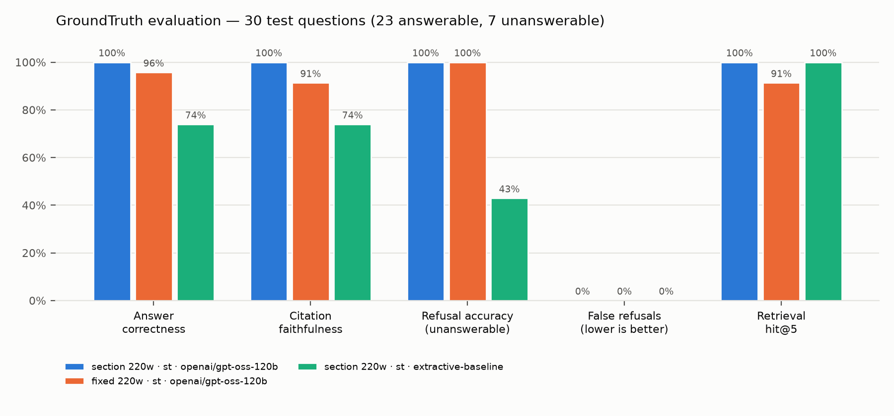
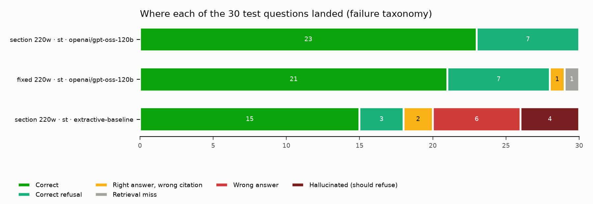
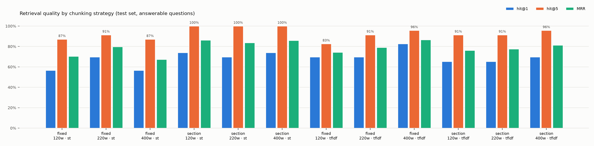

# GroundTruth evaluation report

Test set: 30 hand-written questions (23 answerable, 7 deliberately unanswerable), written before looking at model output. Definitions are in `groundtruth/evaluation.py`.

| Metric | `test-section220-main` | `test-fixed220-baseline` | `test-section220-nollm` |
|---|---|---|---|
| answer_correctness | 1.0 | 0.957 | 0.739 |
| citation_faithfulness | 1.0 | 0.913 | 0.739 |
| refusal_accuracy | 1.0 | 1.0 | 0.429 |
| false_refusal_rate | 0.0 | 0.0 | 0.0 |
| retrieval_hit@5 | 1.0 | 0.913 | 1.0 |
| sentence_support_rate | 1.0 | 0.978 | 1.0 |
| mrr | 0.837 | 0.797 | 0.837 |
| harm_weighted_error | 0.0 | 0.032 | 0.317 |
| avg_latency_s | 5.61 | 9.68 | 0.07 |

## Chunking comparison (retrieval only)

| Embedder | Chunker | Size (words) | Chunks | Hit@1 | Hit@3 | Hit@5 | MRR | AUROC | Missed |
|---|---|---|---|---|---|---|---|---|---|
| st | fixed | 120 | 251 | 56% | 87% | 87% | 0.70 | 0.93 | t18,t20,t22 |
| st | fixed | 220 | 118 | 70% | 91% | 91% | 0.80 | 0.82 | t18,t20 |
| st | fixed | 400 | 64 | 56% | 78% | 87% | 0.67 | 0.86 | t11,t19,t20 |
| st | section | 120 | 254 | 74% | 100% | 100% | 0.86 | 0.96 | — |
| st | section | 220 | 178 | 70% | 96% | 100% | 0.84 | 0.96 | — |
| st | section | 400 | 148 | 74% | 96% | 100% | 0.86 | 0.99 | — |
| tfidf | fixed | 120 | 251 | 70% | 78% | 83% | 0.74 | 0.92 | t15,t16,t18,t20 |
| tfidf | fixed | 220 | 118 | 70% | 91% | 91% | 0.79 | 0.91 | t18,t20 |
| tfidf | fixed | 400 | 64 | 83% | 91% | 96% | 0.87 | 0.92 | t20 |
| tfidf | section | 120 | 254 | 65% | 83% | 91% | 0.76 | 0.91 | t16,t20 |
| tfidf | section | 220 | 178 | 65% | 91% | 91% | 0.78 | 0.88 | t16,t20 |
| tfidf | section | 400 | 148 | 70% | 91% | 96% | 0.81 | 0.86 | t20 |

## Failure log

### Failures — `test-section220-main`

| ID | Outcome | Question | What it said | Top score |
|---|---|---|---|---|

### Failures — `test-fixed220-baseline`

| ID | Outcome | Question | What it said | Top score |
|---|---|---|---|---|
| t18 | correct_bad_citation | Above what dollar amount do I need a receipt for a travel expense? | Receipts are required for any expense that exceeds $75 (and for local‑voucher expenses the threshold is $25)[1][2]. | 0.553 |
| t20 | retrieval_miss | How soon after returning from a trip should I submit my travel voucher? | You may submit your travel voucher for reimbursement as soon as you return from your trip[4]. | 0.6421 |

### Failures — `test-section220-nollm`

| ID | Outcome | Question | What it said | Top score |
|---|---|---|---|---|
| t02 | wrong_answer | I've been a federal employee for 5 years. How much annual leave do I earn each pay period? | You will earn 56 more annual leave hours (14 pay periods x 4 hours per pay period). [2] You earn 4 annual leave hours per pay period and there are 14 pay period… | 0.6872 |
| t09 | wrong_answer | If I'm approved for administrative leave to vote on election day, what is the maximum amount of time I can take? | In rare circumstances, authorized agency officials may approve limited amounts of administrative leave on election day when there is no reasonable opportunity f… | 0.634 |
| t11 | wrong_answer | When does regular comp time expire, and what happens to it if I leave GSA? | If you leave GSA, any unused travel comp time will be forfeited. [1] If you leave GSA, your comp time will be paid out. [2] | 0.7572 |
| t16 | wrong_answer | After paid parental leave, how long do I have to agree to return to work? | Refer to the Paid Parental Leave page for more information, including requesting PPL. [1] Paid Parental Leave. [1] | 0.624 |
| t17 | correct_bad_citation | How much bereavement leave can I use per year for a civilian family member, and how much funeral leave do I get for an immediate relative's combat-related death? | You can use up to 13 days (104 hours) per year of your sick leave for bereavement, funeral planning, and/or attending the funeral of a family member. [2] You ca… | 0.7349 |
| t18 | wrong_answer | Above what dollar amount do I need a receipt for a travel expense? | Follow the guidance above for keeping receipts, and also be mindful of budget-- do not exceed the overall amount budgeted for your travel in your authorization … | 0.711 |
| t20 | correct_bad_citation | How soon after returning from a trip should I submit my travel voucher? | For vouchers, reimbursement will be issued to your personal account and travel card 3-5 business days after travel team approval. [1] Your voucher will be revie… | 0.6665 |
| t23 | wrong_answer | What counts as a 'large team gathering' that needs the event request process instead of an approval email? | Instead of obtaining an email of approval, you must follow the event request process. [1] Authorizing official approval is secured via the event request process… | 0.5991 |
| u01 | hallucinated | What is the maximum per diem lodging rate for a hotel in Chicago? | In the side bar you can filter your search results to only those under the Per diem rate by checking Hide hotels over Per Diem limit ($XXX.00). [1] Box 1: Autho… | 0.6243 |
| u02 | hallucinated | What is the daily meals and incidental expenses rate in Boston? | The allowance for Meals and Incidental Expenses (M&IE) is a flat rate given to a traveler regardless of what they actually spent. [1] How should I claim meals a… | 0.5311 |
| u04 | hallucinated | Can I fly business class on an international flight longer than 14 hours? | Keep in mind that in addition to the $35 fee for using AdTrav, and flights available on other airlines may be more expensive and could strain your project or un… | 0.4197 |
| u07 | hallucinated | Can I expense a pet boarding fee while I'm on official travel? | Laundry expenses, if official travel is at least 4 nights. [2] | 0.4923 |
